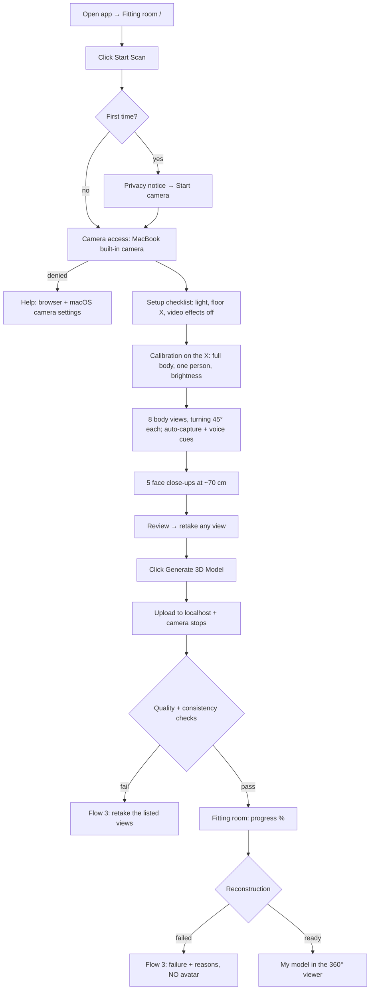
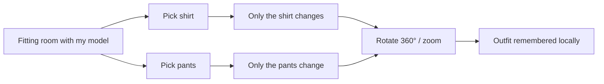
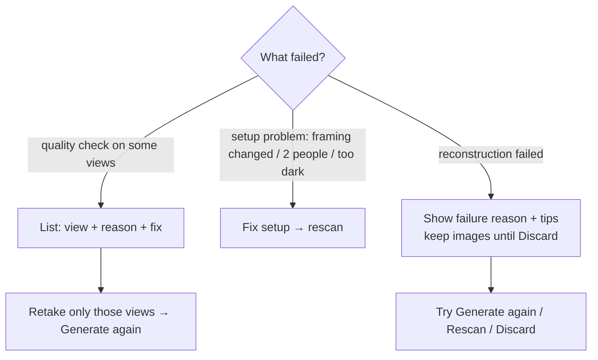
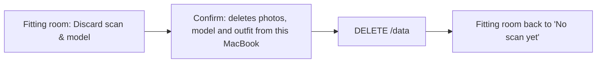

# User Flows (v3 — single user, MacBook camera, CR-02)

One user (the owner), one MacBook. No login, accounts or profiles. Screens match [wireframes/](wireframes/README.md).

---

## Flow 1 — Scan and generate my 3D model

| # | Step | System does |
|---|------|-------------|
| 1 | Opens `http://localhost:5173` | Shows the fitting room: "No scan yet" + **Start Scan** |
| 2 | Clicks **Start Scan** | First time: privacy notice |
| 3 | Allows camera | `getUserMedia` on the built-in camera |
| 4 | Ticks the setup checklist | — |
| 5 | Stands on the X; calibration turns green | MediaPipe pose + brightness; stores person height |
| 6 | Turns 45° at a time (8 views) | Auto-capture when orientation is right and still ≥ 1 s; voice cues |
| 7 | Comes closer for 5 face close-ups | Face-size guide |
| 8 | Reviews and retakes | Images kept in memory only |
| 9 | Clicks **Generate 3D Model** | Uploads to localhost (encrypted, metadata removed), **camera stops**, checks run |
| 10 | Back in the fitting room, sees progress | Reconstruction job runs (minutes) |
| 11 | Sees the model, rotates 360° | GLB streamed from localhost |

## Flow 2 — Try on shirts and pants

- Choosing a shirt never reloads the body or the pants, and choosing pants never changes the shirt.
- "None" removes that garment.
- Before a model exists, the pickers can be browsed but nothing is rendered on a body. **No sample or avatar body is shown in its place.**

## Flow 3 — Problems: retake or failed reconstruction

Rules:
- Every problem is shown in plain words with a fix (codes in [capture-steps.md](capture-steps.md)).
- A failed reconstruction **never** shows a generic avatar. The viewer stays empty with the reason.
- After 3 failed attempts, show the full capture guide.

## Flow 4 — Discard everything

