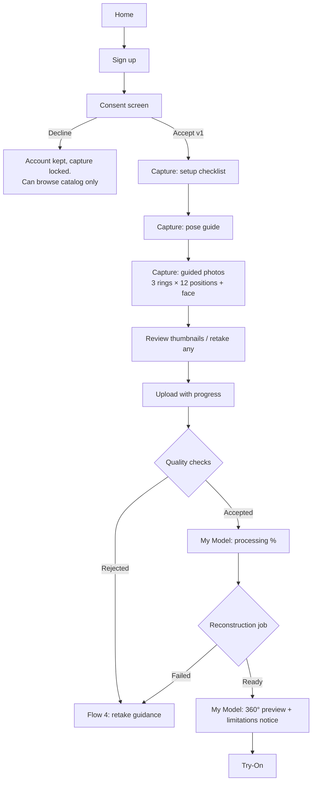
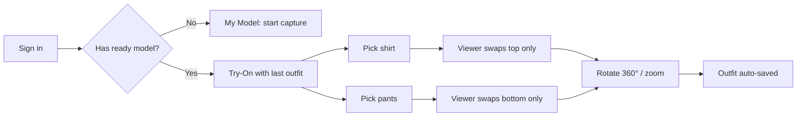
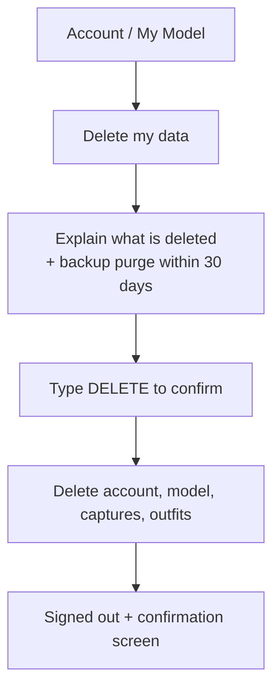
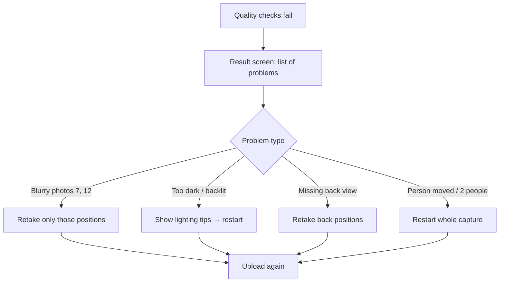

# User Flows (v1)

Four core flows for the MVP. Screen names match the wireframes in [wireframes/](wireframes/README.md).

---

## Flow 1 — First visit: sign up → scan → see my model

| # | Step | Screen | System does |
|---|------|--------|-------------|
| 1 | Taps **Get started** | Home | — |
| 2 | Enters email + password | Sign up | Creates account (password hashed) |
| 3 | Reads and accepts consent | Consent | Stores consent record `v1` with time |
| 4 | Confirms setup checklist (light, clothes, helper present) | Capture | — |
| 5 | Person stands in A-pose; helper follows on-screen positions | Capture | Live brightness hint |
| 6 | Reviews thumbnails, retakes bad ones | Capture | — |
| 7 | Taps **Upload** | Capture | Encrypted upload, strips EXIF |
| 8 | Waits | My Model | Quality checks, then queues reconstruction job |
| 9 | Sees progress (%) — may leave and come back | My Model | Job runs (may take minutes) |
| 10 | Rotates finished model | My Model | Streams private GLB |
| 11 | Taps **Try on clothes** | Try-On | — |

## Flow 2 — Return visit: try on outfits

| # | Step | System does |
|---|------|-------------|
| 1 | Signs in | Session cookie |
| 2 | Lands on Try-On | Loads saved model + last outfit (no rescan) |
| 3 | Picks a shirt | Loads only the shirt GLB; body and pants stay |
| 4 | Picks pants | Loads only the pants GLB |
| 5 | Rotates / zooms | Client-side only |
| 6 | Leaves | Outfit saved |

## Flow 3 — Delete my profile

Options on this screen:
- **Delete my 3D model only.** Keeps the account and lets the user rescan later.
- **Delete my account and all data.** Deletes everything.
- **Export my data first** (a link to the export).

## Flow 4 — Capture rejected → retake

Rules:
- Each problem is shown in plain words with a fix, e.g. *"Photo 7 is blurry. Hold the phone still and tap to focus."*
- If only a few photos are bad, retake just those. If the problem affects the whole set, restart.
- After **3 failed attempts**, show the full capture guide and suggest a better place or time.
